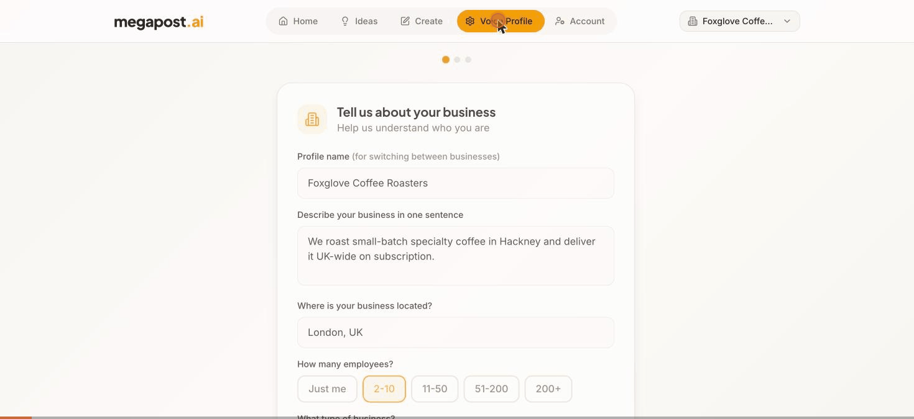

# Megapost

AI-powered social post generator that writes in **your brand voice** — not generic LLM voice.

Users build a voice profile (tone sliders, sample posts, brand beliefs, content pillars), then generate platform-specific posts from a short description and optional image. Full SaaS wrapper: free trial, three paid tiers via Stripe, one-click direct publishing to LinkedIn, admin dashboard.

> **Status:** working application, built January–February 2026 (~340 commits), developed with Claude Code. Not currently hosted — the demo below shows it running against the live backend.

## Demo



*One description in, three platform-tailored posts out — LinkedIn long-form, Instagram caption with hashtags, X short-form — all in the saved brand voice.*

## Features

- **Voice profiles** — tone scales, business context, sample posts and brand beliefs steer every generation; multiple business profiles per account
- **Post generation** — platform + description + optional image (Gemini vision) → ready-to-publish posts per platform
- **Content pillars** — AI-suggested brand topics that keep output on-strategy
- **LinkedIn direct posting** — OAuth connect, one-click publish with token refresh handling
- **Billing** — Stripe checkout, customer portal, tiered generation limits, 7-day trial with abuse prevention
- **Lifecycle email** — welcome and trial-expiry emails via Resend
- **Admin dashboard** — usage stats and per-user generation counts
- **Production hygiene** — Sentry error tracking + session replay, PostHog analytics, error boundaries, CI (lint/test/build) on GitHub Actions

## Architecture

React 18 + TypeScript SPA (Vite, Tailwind, shadcn/ui, TanStack Query) on a Supabase backend: Postgres with row-level security plus 15 Deno edge functions handling everything server-side — Gemini generation, Stripe billing, LinkedIn OAuth/publishing, transactional email, account lifecycle.

```
src/
  pages/          Index (dashboard), Auth, Admin, Privacy, Terms
  components/     VoiceSetup, ContentGenerator, PostHistory, BusinessSwitcher, ...
  hooks/          useAuth, useSubscription, usePostLimit, useLinkedIn, useContentPillars
  lib/            sentry, posthog, typed analytics events
supabase/
  functions/      generate-posts, create-checkout, post-to-linkedin, admin-stats, ... (15)
  migrations/     Postgres schema + RLS policies
```

Secrets (Gemini, Stripe, Resend, LinkedIn) live exclusively in Supabase's secret store, server-side. The client env (`.env.example`) contains only publishable values.

## Run locally

The frontend runs against any Supabase project — full setup means standing up your own backend:

```bash
npm install
cp .env.example .env   # your Supabase project's publishable values
npm run dev            # http://localhost:8080
```

Then, on your Supabase project: apply the migrations (`supabase db push`), deploy the edge functions (`supabase functions deploy`), and set the server-side secrets (`supabase secrets set GEMINI_API_KEY=...` etc.). Sign-up, generation and billing all run through that backend, so nothing works without it — the demo GIF above is the quickest way to see the app in action.

## Tests

```bash
npm test               # 32 unit tests (Vitest + Testing Library)
npx playwright test    # E2E scaffolding (needs a dedicated test account)
```

## History

Started as a Lovable prototype, then migrated to a self-hosted Supabase stack (`migrate-to-self-hosted` branch — the deployed line): custom edge functions, CI/CD, monitoring, tests, and LinkedIn integration were all added post-migration. Previously live at megapost.ai.
